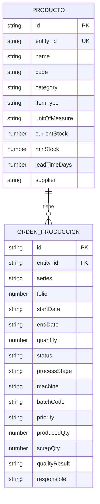
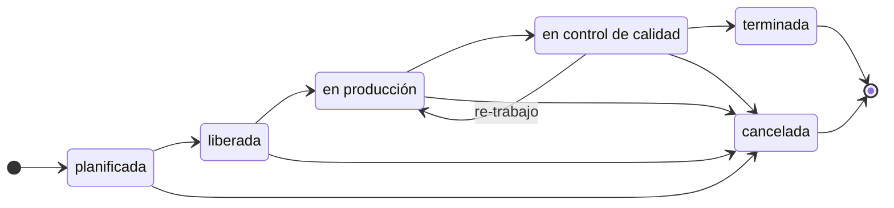

# Modelo de datos: Manufactura y Operaciones

**Grupo 7** · Módulo ERP sobre el módulo base (Vite + JavaScript vanilla)

Este documento explica cómo adaptamos el modelo de datos del módulo base a Manufactura y Operaciones. La idea es no tocar el código central: los campos base se mantienen tal cual y todo lo propio de planta se define en el objeto `userConfig` de `src/module-config.js`.

## Qué representa cada cosa

El módulo base trabaja con dos conceptos, y los usamos así:

| En el módulo base | En nuestro módulo | Qué es |
|---|---|---|
| Entidad | Producto | Dato maestro: producto terminado, materia prima o insumo |
| Documento | Orden de Producción | Instrucción de fabricar X unidades de un producto en un plazo |

Con esto se responde la pregunta que planteamos en la visión del producto: qué se está produciendo ahora, con qué, y qué está retrasado.

## Diagrama entidad-relación

Un producto puede tener muchas órdenes de producción, y cada orden pertenece a un solo producto. Se vinculan mediante `entity_id`.

## Producto

### Campos propios del dominio

| Clave | Etiqueta | Tipo | Obligatorio | Opciones |
|---|---|---|---|---|
| `itemType` | Tipo de ítem | select | Sí | Producto terminado, Materia prima, Insumo |
| `unitOfMeasure` | Unidad de medida | select | Sí | Unidad, Kg, Litro, Metro, Caja |
| `currentStock` | Stock actual | number | No | |
| `minStock` | Stock mínimo | number | No | |
| `leadTimeDays` | Plazo de reposición (días) | number | No | |
| `supplier` | Proveedor | text | No | |

### Cómo usamos los campos base

| Campo base | Uso |
|---|---|
| `name` | Nombre del producto, materia prima o insumo |
| `code` | SKU o código de producto |
| `category` | Familia o línea |
| `description` | Especificaciones breves |
| `targetDate` | Fecha de revisión |
| `address` | Ubicación de almacenamiento, si se quiere registrar |

Los campos `taxId`, `email`, `phone`, `creditLimit` y `paymentTerms` vienen del módulo base y son opcionales; en manufactura casi no se usan.

Campos base completos de la entidad

| Campo | Tipo | Obligatorio | Restricciones |
|---|---|---|---|
| `id` | string | Sí | Se genera automáticamente |
| `entity_id` | string | Sí | Se genera automáticamente, único |
| `name` | string | Sí | No vacío |
| `code` | string | Sí | No vacío |
| `taxId` | string | No | Se guarda recortada |
| `email` | string | No | Formato de correo válido |
| `phone` | string | No | |
| `address` | string | No | |
| `category` | string | No | |
| `description` | string | No | |
| `targetDate` | string | No | Fecha válida, formato YYYY-MM-DD |
| `creditLimit` | number | No | No negativo |
| `paymentTerms` | string | No | |
| `createdAt` | string | Sí | Marca de tiempo |
| `updatedAt` | string | Sí | Marca de tiempo |

## Orden de Producción

### Campos propios del dominio

| Clave | Etiqueta | Tipo | Obligatorio | Opciones |
|---|---|---|---|---|
| `processStage` | Proceso / Etapa | select | Sí | Corte, Ensamblaje, Pintura, Empaque |
| `machine` | Máquina / Recurso | text | No | |
| `batchCode` | Lote | text | No | |
| `priority` | Prioridad | select | No | Baja, Media, Alta, Urgente |
| `producedQty` | Cantidad producida | number | No | |
| `scrapQty` | Cantidad de merma | number | No | |
| `qualityResult` | Resultado de calidad | select | No | Pendiente, Aprobado, Aprobado con observaciones, Rechazado |
| `responsible` | Responsable | text | No | |

### Cómo usamos los campos base

| Campo base | Uso |
|---|---|
| `entity_id` | Producto que se va a fabricar |
| `series` y `folio` | Número de orden, por ejemplo `OP-1001` |
| `startDate` | Inicio de producción |
| `endDate` | Fecha comprometida de entrega |
| `quantity` | Unidades a fabricar |
| `notes` | Observaciones de planta |
| `status` | Estado de la orden (ver ciclo de vida) |
| `subtotal`, `totalAmount`, `currency` | Costo estimado, si se quiere registrar |

`discount`, `taxAmount` y `paymentTerms` vienen del módulo base y no los usamos en este dominio.

Campos base completos del documento

| Campo | Tipo | Obligatorio | Restricciones |
|---|---|---|---|
| `id` | string | Sí | Se genera automáticamente |
| `entity_id` | string | Sí | Debe corresponder a un producto existente |
| `series` | string | No | |
| `folio` | number | Sí | Entero positivo |
| `startDate` | string | Sí | Fecha válida, formato YYYY-MM-DD |
| `endDate` | string | Sí | Fecha válida, igual o posterior a `startDate` |
| `quantity` | number | No | Entero positivo |
| `subtotal` | number | No | No negativo |
| `discount` | number | No | No negativo, no puede superar el subtotal |
| `taxAmount` | number | No | No negativo |
| `totalAmount` | number | No | No negativo |
| `currency` | string | No | |
| `paymentTerms` | string | No | |
| `notes` | string | No | |
| `status` | string | No | Lo reemplaza el ciclo de vida configurado |
| `createdAt` | string | Sí | Marca de tiempo |
| `updatedAt` | string | Sí | Marca de tiempo |

## Ciclo de vida de la orden

Una orden nace como *planificada* y avanza paso a paso. Si no pasa la inspección de calidad puede volver a *en producción* (re-trabajo). Se puede cancelar desde cualquier estado antes de terminarla, y tanto *terminada* como *cancelada* son estados finales.

## Configuración

Todo está en `src/module-config.js`:

| Propiedad | Valor |
|---|---|
| `moduleName` | Manufactura y Operaciones |
| `labels` | Producto / Productos, Orden de Producción / Órdenes de Producción |
| `customFields` | 6 de Producto y 8 de Orden de Producción |
| `statusLifecycle` | Los 6 estados del diagrama |
| `theme.accentColor` | `#0f766e` |

Las claves de los campos propios no pueden repetir ningún nombre de campo base (`id`, `entity_id`, `name`, `code`, `taxId`, `email`, `phone`, `address`, `category`, `description`, `targetDate`, `creditLimit`, `paymentTerms`, `series`, `folio`, `startDate`, `endDate`, `quantity`, `subtotal`, `discount`, `taxAmount`, `totalAmount`, `currency`, `notes`, `status`). Si la configuración tiene algún error, la aplicación muestra un aviso y vuelve a los valores por defecto en vez de romperse.

## Reglas de validación

**Producto**

- El nombre y el código no pueden estar vacíos.
- Tipo de ítem y unidad de medida son obligatorios y deben ser una de las opciones.
- Stock actual, stock mínimo y plazo de reposición, si se completan, tienen que ser números.
- La fecha de revisión, si se completa, debe ser una fecha válida.
- El `entity_id` se genera solo y no se repite.

**Orden de Producción**

- Debe estar asociada a un producto existente.
- El folio es un entero positivo; la serie es opcional.
- Las fechas de inicio y fin son obligatorias y la de fin no puede ser anterior a la de inicio.
- La cantidad, si se completa, es un entero positivo.
- La etapa del proceso es obligatoria.
- El estado solo puede cambiar siguiendo las transiciones del ciclo de vida.

Hay reglas de negocio que el módulo base no valida y que por ahora quedan fuera, por ejemplo que producción más merma no supere lo planificado, o que una orden no se pueda terminar sin calidad aprobada.

## Relaciones

- Cada producto se guarda de forma independiente y aparece como una fila en la lista.
- Cada orden pertenece a un único producto.
- Si se elimina un producto, se eliminan también todas sus órdenes (cascada).
- La búsqueda recorre los productos, incluidos sus campos propios.

## Cómo quedan las entidades del README

| Entidad del dominio | Dónde queda |
|---|---|
| Producto | Entidad, con `itemType` = Producto terminado |
| Materia prima / Insumo | Entidad, con `itemType` = Materia prima o Insumo |
| Orden de producción | Documento |
| Proceso / Etapa | Campo `processStage` |
| Máquina / Recurso | Campo `machine` |
| Inventario | Campos `currentStock` y `minStock` |
| Proveedor | Campo `supplier` |
| Lote | Campo `batchCode` |
| Control de calidad | Campo `qualityResult` y estado *en control de calidad* |

Máquina, lote, proveedor y control de calidad quedaron como campos y no como tablas propias, porque el módulo base solo maneja un par entidad/documento. Si más adelante necesitamos trazabilidad completa de lotes o capacidad de máquinas, habría que agregar un segundo par.

## Estado del avance

- [x] Modelo de datos definido y documentado
- [x] Configuración del módulo escrita (`userConfig`)
- [ ] Probar la configuración en la aplicación y revisar que no aparezca el aviso de configuración inválida
- [ ] Cargar datos de ejemplo (productos y órdenes) para probar los flujos
- [ ] Alertas de stock bajo y detección de órdenes retrasadas
- [ ] Validar producción + merma frente a la cantidad planificada
- [ ] Consumo de materia prima por orden
