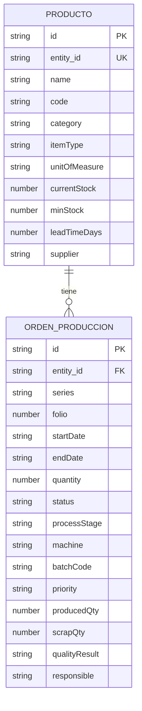
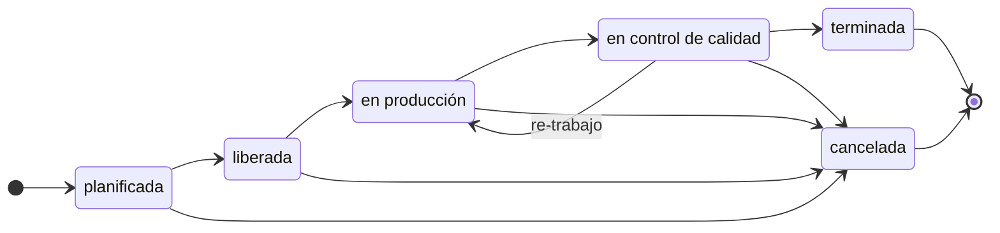

# Modelo de datos: Manufactura y Operaciones

**Grupo 7** · Módulo ERP sobre el módulo base (Vite + JavaScript vanilla)

Este documento explica cómo adaptamos el modelo de datos del módulo base a Manufactura y Operaciones. La idea es no tocar el código central: los campos base se mantienen tal cual y todo lo propio de planta se define en la configuración de `src/module-config.js`. El perfil de manufactura es completamente declarativo; el motor genérico de `src/domain/` interpreta vistas, métricas, insignias y reglas.

## Qué representa cada cosa

| En el módulo base | En nuestro módulo | Qué es |
|---|---|---|
| Entidad | Producto | Dato maestro: producto terminado, materia prima o insumo |
| Documento | Orden de Producción | Instrucción de fabricar X unidades de un producto en un plazo |

Con esto se responde la pregunta que planteamos en la visión del producto: qué se está produciendo ahora, con qué, y qué está retrasado.

## Diagrama entidad-relación

Un producto puede tener muchas órdenes de producción, y cada orden pertenece a un solo producto. Se vinculan mediante `entity_id`.

## Producto

### Campos propios del dominio

| Clave | Etiqueta | Tipo | Obligatorio | Opciones |
|---|---|---|---|---|
| `itemType` | Tipo de ítem | select | Sí | Producto terminado, Materia prima, Insumo |
| `unitOfMeasure` | Unidad de medida | select | Sí | Unidad, Kg, Litro, Metro, Caja |
| `currentStock` | Stock actual | number | No | No negativo |
| `minStock` | Stock mínimo | number | No | No negativo |
| `leadTimeDays` | Plazo de reposición (días) | number | No | No negativo |
| `supplier` | Proveedor | text | No | |

### Cómo usamos los campos base

| Campo base | Uso |
|---|---|
| `name` | Nombre del producto, materia prima o insumo |
| `code` | SKU o código de producto |
| `category` | Familia o línea |
| `description` | Especificaciones breves |
| `targetDate` | Fecha de revisión |
| `address` | Ubicación de almacenamiento, si se quiere registrar |

Los campos `taxId`, `email`, `phone`, `creditLimit` y `paymentTerms` vienen del módulo base y son opcionales; en manufactura casi no se usan.

Campos base completos de la entidad

| Campo | Tipo | Obligatorio | Restricciones |
|---|---|---|---|
| `id` | string | Sí | Se genera automáticamente |
| `entity_id` | string | Sí | Se genera automáticamente, único |
| `name` | string | Sí | No vacío |
| `code` | string | Sí | No vacío |
| `taxId` | string | No | Se guarda recortada |
| `email` | string | No | Formato de correo válido |
| `phone` | string | No | |
| `address` | string | No | |
| `category` | string | No | |
| `description` | string | No | |
| `targetDate` | string | No | Fecha válida, formato YYYY-MM-DD |
| `creditLimit` | number | No | No negativo |
| `paymentTerms` | string | No | |
| `createdAt` | string | Sí | Marca de tiempo |
| `updatedAt` | string | Sí | Marca de tiempo |

### Regla de stock bajo el mínimo

Un producto se marca como **"stock bajo el mínimo"** solo cuando:

- `currentStock` y `minStock` existen, y
- `currentStock < minStock` (estrictamente menor).

Si falta cualquiera de los dos valores, la interfaz muestra **"sin dato"** y no aplica la insignia de stock bajo. Un valor ausente nunca se trata como cero.

## Orden de Producción

### Campos propios del dominio

| Clave | Etiqueta | Tipo | Obligatorio | Opciones |
|---|---|---|---|---|
| `processStage` | Proceso / Etapa | select | Sí | Corte, Ensamblaje, Pintura, Empaque |
| `machine` | Máquina / Recurso | text | No | |
| `batchCode` | Lote | text | No | |
| `priority` | Prioridad | select | No | Baja, Media, Alta, Urgente |
| `producedQty` | Cantidad producida | number | No | No negativo |
| `scrapQty` | Cantidad de merma | number | No | No negativo |
| `qualityResult` | Resultado de calidad | select | No | Pendiente, Aprobado, Corrección, Rechazado |
| `responsible` | Responsable | text | No | |

### Correspondencia con los nombres de calidad de la especificación

| Nombre en la especificación | Clave canónica de datos | Etiqueta de interfaz |
|---|---|---|
| `CantidadQA` | `producedQty` | Cantidad QA |
| `MermaQA` | `scrapQty` | Merma QA |
| `CalidadQA` | `qualityResult` | Calidad QA |
| `nota` | `notes` | Nota |

Las claves canónicas se usan en almacenamiento, búsqueda, métricas y reglas. Las etiquetas visibles conservan la terminología de las historias de usuario.

### Cómo usamos los campos base

| Campo base | Uso |
|---|---|
| `entity_id` | Producto que se va a fabricar |
| `series` y `folio` | Número de orden, por ejemplo `OP-1001` |
| `startDate` | Inicio de producción |
| `endDate` | Fecha comprometida de entrega |
| `quantity` | Unidades a fabricar |
| `notes` | Observaciones de planta y notas de calidad |
| `status` | Estado de la orden (ver ciclo de vida) |
| `subtotal`, `totalAmount`, `currency` | Costo estimado, si se quiere registrar |

`discount`, `taxAmount` y `paymentTerms` vienen del módulo base y no los usamos en este dominio.

Campos base completos del documento

| Campo | Tipo | Obligatorio | Restricciones |
|---|---|---|---|
| `id` | string | Sí | Se genera automáticamente |
| `entity_id` | string | Sí | Debe corresponder a un producto existente |
| `series` | string | No | |
| `folio` | number | Sí | Entero positivo |
| `startDate` | string | Sí | Fecha válida, formato YYYY-MM-DD |
| `endDate` | string | Sí | Fecha válida, igual o posterior a `startDate` |
| `quantity` | number | No | Entero positivo |
| `subtotal` | number | No | No negativo |
| `discount` | number | No | No negativo, no puede superar el subtotal |
| `taxAmount` | number | No | No negativo |
| `totalAmount` | number | No | No negativo |
| `currency` | string | No | |
| `paymentTerms` | string | No | |
| `notes` | string | No | |
| `status` | string | No | Lo reemplaza el ciclo de vida configurado |
| `createdAt` | string | Sí | Marca de tiempo |
| `updatedAt` | string | Sí | Marca de tiempo |

## Ciclo de vida de la orden

Una orden nace como *planificada* y avanza paso a paso. Si no pasa la inspección de calidad puede volver a *en producción* (re-trabajo). Se puede cancelar desde cualquier estado antes de terminarla, y tanto *terminada* como *cancelada* son estados finales.

Las acciones de dominio se declaran como transiciones y guardas:

- **Confirmar pedido**: `planificada → liberada`.
- **Rechazar pedido**: `planificada → cancelada`.
- **Iniciar producción**: `liberada → en producción`, requiriendo máquina, lote y etapa cuando la configuración lo exija.
- **Enviar a calidad**: `en producción → en control de calidad`.
- **Aprobar**: `en control de calidad → terminada`, requiriendo `qualityResult = Aprobado`.
- **Devolver a producción**: `en control de calidad → en producción`, requiriendo `qualityResult = Corrección`.
- **Rechazar lote**: `en control de calidad → cancelada`, requiriendo `qualityResult = Rechazado`.

## Vistas y comportamiento de dominio

La lista y el detalle de órdenes viven dentro del **módulo Documentos**. La configuración declara:

- **Columnas de lista**: serie, folio, producto, cantidad, fechas, estado, prioridad y campos de ejecución relevantes.
- **Filtros**: por estado y por retraso; los estados disponibles provienen del ciclo de vida.
- **Secciones de detalle**: pedido, ejecución y calidad.
- **Indicadores**: conteo por estado, conteo de retrasadas, merma por orden y resumen de costos.
- **Costos**: subtotal, descuento, impuesto y total por orden, con totales separados por moneda; nunca se suman monedas distintas.
- **Insignias**: stock bajo el mínimo en productos y orden retrasada en documentos.
- **Estados vacíos**: cero órdenes o cero resultados muestran valores en cero y un mensaje claro.

La pantalla de gestión no muestra la lista de entidades (FR-016). Las referencias a "la lista" de entidades corresponden a los resultados de la pantalla Buscar.

## Configuración declarativa

Todo está en `src/module-config.js`. El perfil está **activo**: `userConfig = manufacturingConfig`. Para volver al módulo base genérico basta con `userConfig = null`; `manufacturingConfig` queda como perfil de referencia completo.

| Propiedad | Valor en `manufacturingConfig` |
|---|---|
| `userConfig` | `manufacturingConfig` (perfil de manufactura activo) |
| `moduleName` | Manufactura y Operaciones |
| `labels` | Producto / Productos, Orden de Producción / Órdenes de Producción |
| `customFields` | 6 de Producto y 8 de Orden de Producción |
| `statusLifecycle` | Los 6 estados del diagrama |
| `theme.accentColor` | `#0f766e` |
| `domain.documentList` | Columnas, filtros y secciones de detalle de la orden |
| `domain.documentList.forms` | Formularios configurables de ejecución y calidad |
| `domain.indicators` | Conteo por estado, retrasos y merma por orden |
| `domain.costSummary` | Agrupación por moneda |
| `domain.badges` | Stock bajo y orden retrasada |
| `domain.rules` | Guardas de calidad y transiciones |
| `domain.transitionActions` | Etiquetas de confirmar, rechazar, iniciar, enviar a calidad, aprobar y devolver |
| `domain.transitionGuards` | Condiciones declarativas por transición |

La forma completa y las operaciones permitidas están en [contracts/module-extension.md](contracts/module-extension.md).

### Validación de la configuración

Las claves de los campos propios no pueden repetir ningún nombre de campo base (`id`, `entity_id`, `name`, `code`, `taxId`, `email`, `phone`, `address`, `category`, `description`, `targetDate`, `creditLimit`, `paymentTerms`, `series`, `folio`, `startDate`, `endDate`, `quantity`, `subtotal`, `discount`, `taxAmount`, `totalAmount`, `currency`, `notes`, `status`). Si la configuración tiene algún error, la aplicación muestra un aviso y vuelve a los valores por defecto en vez de romperse.

Se rechazan además:

- Operaciones de regla fuera de la lista blanca.
- Referencias a campos que no existen en los campos base ni en `customFields`.
- Indicadores o insignias con tipos desconocidos.
- Filtros que apunten a estados fuera del ciclo de vida configurado.
- Vistas sin columnas o con secciones de detalle vacías.

## Reglas de validación

**Producto**

- El nombre y el código no pueden estar vacíos.
- Tipo de ítem y unidad de medida son obligatorios y deben ser una de las opciones.
- Stock actual, stock mínimo y plazo de reposición, si se completan, deben ser números no negativos.
- La fecha de revisión, si se completa, debe ser una fecha válida.
- El `entity_id` se genera solo y no se repite.
- La insignia de stock bajo sigue la regla estricta definida arriba.

**Orden de Producción**

- Debe estar asociada a un producto existente.
- El folio es un entero positivo; la serie es opcional.
- Las fechas de inicio y fin son obligatorias y la de fin no puede ser anterior a la de inicio.
- La cantidad, si se completa, es un entero positivo.
- La etapa del proceso es obligatoria.
- Cantidades producidas y merma, si se completan, deben ser números no negativos; se rechazan valores negativos o no numéricos.
- El estado solo puede cambiar siguiendo las transiciones del ciclo de vida y las guardas configuradas.
- En estado *en control de calidad*, el resultado de calidad debe ser uno de los valores declarados antes de pasar a *terminada*, *en producción* o *cancelada*.

Hay reglas de negocio que el módulo base no valida y que por ahora quedan fuera, por ejemplo que producción más merma no supere lo planificado, o que una orden no se pueda terminar sin calidad aprobada cuando la configuración no lo declare. Esas reglas pueden añadirse como guardas declarativas en una etapa posterior.

## Seguridad de renderizado

Los valores de entidades, documentos, campos personalizados y notas se escapan antes de insertarse en el DOM (FR-050). El modelo no almacena HTML: los campos de texto son texto plano y se renderizan con `textContent` o con el ayudante de escape centralizado. Las pruebas usan payloads XSS para verificar que no se ejecutan scripts.

## Relaciones

- Cada producto se guarda de forma independiente y aparece en el selector de gestión y en los resultados de búsqueda (la pantalla de gestión no muestra una lista, según FR-016).
- Cada orden pertenece a un único producto.
- Si se elimina un producto, se eliminan también todas sus órdenes (cascada).
- La búsqueda recorre los productos, incluidos sus campos propios.
- La lista y el detalle de órdenes se muestran dentro del módulo Documentos.

## Cómo quedan las entidades del README

| Entidad del dominio | Dónde queda |
|---|---|
| Producto | Entidad, con `itemType` = Producto terminado |
| Materia prima / Insumo | Entidad, con `itemType` = Materia prima o Insumo |
| Orden de producción | Documento |
| Proceso / Etapa | Campo `processStage` |
| Máquina / Recurso | Campo `machine` |
| Inventario | Campos `currentStock` y `minStock` |
| Proveedor | Campo `supplier` |
| Lote | Campo `batchCode` |
| Control de calidad | Campo `qualityResult` y estado *en control de calidad* |

Máquina, lote, proveedor y control de calidad quedaron como campos y no como tablas propias, porque el módulo base solo maneja un par entidad/documento. Si más adelante necesitamos trazabilidad completa de lotes o capacidad de máquinas, habría que agregar un segundo par.

## Estado del avance

- [x] Modelo de datos definido y documentado
- [x] Configuración de referencia escrita (`manufacturingConfig`) y activada en `userConfig`
- [x] Validación de configuración extendida a vistas, indicadores, insignias, formularios y reglas
- [x] Motor declarativo implementado (`src/domain/`) sin funciones ni código ejecutable en la configuración
- [x] Flujos de dominio HU1-HU5 revisados y cubiertos por pruebas (lista/detalle, confirmar/rechazar, ejecución y calidad)
- [x] Datos de ejemplo sembrados por las pruebas de integración y E2E
- [x] Pruebas unitarias, de integración y E2E de los recorridos críticos
- [x] Perfil activo sin aviso de configuración inválida
- [x] Puerta de calidad: 263 pruebas unitarias/integración, 10 E2E, lint y formato limpios, build correcto
- [ ] Notificaciones automáticas de stock bajo y de órdenes retrasadas (la identificación en pantalla está cubierta por FR-042/FR-046)
- [ ] Validar producción + merma frente a la cantidad planificada
- [ ] Consumo de materia prima por orden
