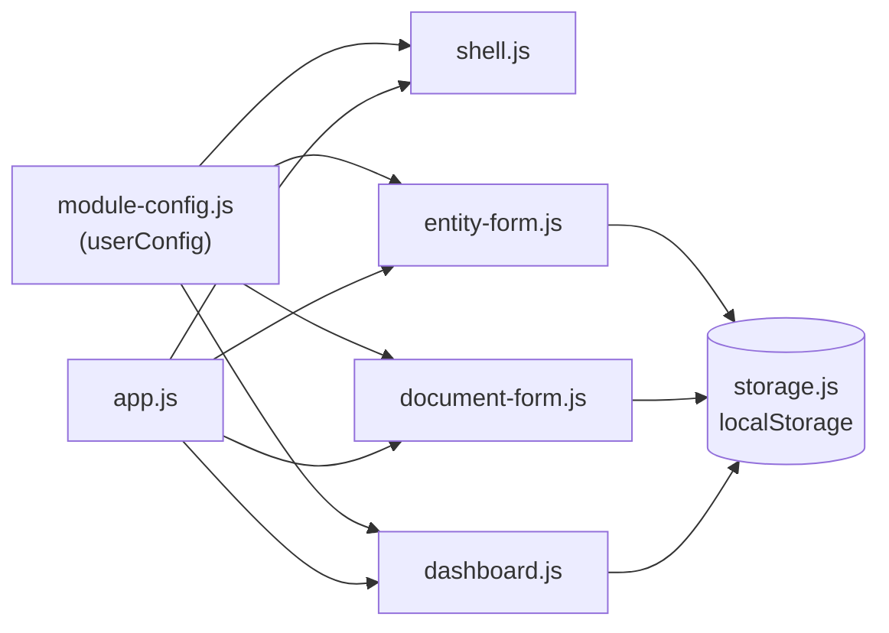

# Plan de Implementación: Módulo ERP de Manufactura y Operaciones

**Rama**: `001-erp-base-module` | **Fecha**: 2026-07-08 | **Especificación**: [spec.md](spec.md)
**Entrada**: Especificación de la funcionalidad desde `/specs/001-erp-base-module/spec.md`

## Resumen

Construir una aplicación web ligera con Vite que sirva como módulo ERP de manufactura y operaciones, apoyada en el módulo base de planificación de recursos empresariales. El módulo base proporciona lo común a todo módulo ERP: gestión de datos maestros (Entidades), documentos transaccionales vinculados (Documentos), flujos de crear, editar, eliminar y buscar, validación y persistencia local, construido principalmente con HTML, CSS y JavaScript vanilla.

La aplicación se presenta como un espacio de trabajo ERP coherente: una barra superior con marca (logotipo derivado y nombre del módulo) y una barra lateral persistente de botones de módulo envuelven cada pantalla. La pantalla de entrada es un panel con botones de acción rápida para las tareas clave (nuevo producto, nueva orden de producción, abrir las áreas de gestión, buscar registros) y estadísticas de registros en vivo.

La adaptación a manufactura se realiza mediante el único archivo de configuración `src/module-config.js`, de modo que el código central permanece intacto:

| Concepto base | En Manufactura y Operaciones |
|---|---|
| Entidad | Producto (producto terminado, materia prima o insumo) |
| Documento | Orden de Producción |

El archivo de configuración cubre además la terminología, los campos personalizados del dominio (etapa del proceso, máquina, lote, prioridad, cantidad producida, merma, resultado de calidad, entre otros), el ciclo de vida de la orden y el color de acento. El detalle se encuentra en [data-model.md](data-model.md).

## Contexto Técnico

**Lenguaje/Versión**: JavaScript (ES2022), HTML, CSS  
**Dependencias Principales**: Vite, sin framework de interfaz pesado  
**Almacenamiento**: localStorage del navegador para una instancia del módulo de espacio único  
**Pruebas**: Vitest con jsdom para pruebas unitarias y de interacción  
**Plataforma Objetivo**: Navegadores modernos de escritorio y móviles  
**Tipo de Proyecto**: Aplicación web  
**Objetivos de Rendimiento**: Interacciones responsivas para listas de hasta 500 registros; la búsqueda y las actualizaciones de la interfaz deben sentirse instantáneas  
**Restricciones**: Huella mínima de librerías, despliegue simple, sin backend requerido; la estructura debe mantenerse extensible para módulos personalizados  
**Escala/Alcance**: CRUD de datos maestros (Producto) y documentos transaccionales (Orden de Producción), búsqueda y capacidades de navegación

## Verificación de la Constitución

*COMPROBACIÓN: Debe pasar antes de la investigación de la Fase 0. Reverificar tras el diseño de la Fase 1.*

- **Calidad**: La implementación usará una estructura JavaScript pequeña y modular, con límites de función claros y nomenclatura consistente. Las preocupaciones base (almacenamiento, identidad, integridad referencial) permanecen separadas de la lógica específica de manufactura, que vive únicamente en la configuración.
- **Pruebas**: Los flujos centrales de crear, editar, eliminar y buscar estarán cubiertos por pruebas automatizadas antes de completar.
- **Experiencia de Usuario**: La interfaz proporcionará mensajes de validación claros, estados vacíos y comportamiento de formulario consistente, presentados dentro de un marco de espacio de trabajo ERP con marca (barra superior y barra lateral) que se ve y se comporta idénticamente en todas las pantallas.
- **Rendimiento**: La búsqueda y el renderizado de listas se optimizarán para colecciones de hasta 500 registros usando actualizaciones ligeras del DOM.

## Estructura del Proyecto

### Documentación (esta funcionalidad)

```text
specs/001-erp-base-module/
├── plan.md
├── research.md
├── data-model.md
├── quickstart.md
├── contracts/
└── tasks.md
```

### Código Fuente (raíz del repositorio)

```text
src/
├── main.js
├── styles.css
├── storage.js
├── app.js
├── module-config.js
└── components/
    ├── shell.js        (marco del espacio de trabajo: barra superior, logotipo SVG, barra lateral, estado de módulo activo)
    ├── dashboard.js    (vista de inicio: cuadrícula de acciones rápidas + tarjetas de estadísticas en vivo)
    ├── entity-form.js  (formulario de creación/edición de productos con campos personalizados)
    └── document-form.js (formulario de creación/edición de órdenes con campos personalizados y ciclo de vida de estados)

tests/
├── unit/
├── integration/
└── setup/
```

**Decisión de Estructura**: Una aplicación Vite simple con un único punto de entrada HTML, un pequeño conjunto de módulos JavaScript y CSS en un archivo separado. Se usará localStorage para la persistencia, de modo que la aplicación permanezca ligera y autónoma. Los componentes se dividen en pares de entidad (datos maestros) y documento (transaccional), que reflejan los dos conceptos centrales del módulo base, de modo que cada par pueda renombrarse o extenderse de forma independiente.

`shell.js` posee el marco del espacio de trabajo: un logotipo monograma SVG en línea derivado del nombre del módulo, la barra superior y la barra lateral de módulos, que envuelven todas las vistas para mantener la marca y la navegación consistentes sin duplicar marcado. `dashboard.js` renderiza los botones de acción rápida y las tarjetas de estadísticas de la pantalla de entrada, leyendo los recuentos del almacenamiento cada vez que se vuelve visible. `module-config.js` centraliza todos los puntos de adaptación (nombre del módulo, etiquetas de términos, definiciones de campos personalizados, ciclo de vida de estados y color de acento), manteniendo la personalización del dominio fuera del código central. El estilo se controla mediante propiedades personalizadas de CSS (tokens de diseño) en `styles.css`, para que el color de acento configurado se aplique globalmente.



## Seguimiento de Complejidad

Este plan no introdujo violaciones de la constitución. La adaptación a manufactura se resuelve únicamente con configuración, sin agregar capas ni dependencias.

---

# Anexo: Informe de Avance

| | |
|---|---|
| **Equipo** | Grupo 7 |
| **Tipo de entrega** | Avance |
| **Fecha de entrega** | _[completar]_ |

| Integrante | Rol |
|---|---|
| Vicente Javier Seguel Fuentes | Líder de producto |
| Rafael Antonio Machuca López | Arquitecto de datos |
| Constanza Andrea Chavarría Ortiz | Diseño de experiencia y usuario |
| Francisca Belén Torres Torres | Control de calidad del producto |
| Alonso Javier Romero Gutiérrez | Desarrollo e infraestructura |

## Alcance de esta etapa

**Incluido**: gestión de productos y órdenes de producción, búsqueda, validación, persistencia local y espacio de trabajo con panel de inicio.

**Fuera de alcance**: lista de materiales y consumo de insumos por orden; máquinas, lotes y proveedores como registros independientes; alertas automáticas de stock bajo y de órdenes retrasadas; backend, autenticación y múltiples usuarios.

## Estado del avance

| Entregable | Estado |
|---|---|
| Especificación funcional | Completado |
| Modelo de datos documentado | Completado |
| Configuración del módulo (`userConfig`) | Completado, pendiente de validación en la aplicación |
| Validación de la configuración en ejecución | Pendiente |
| Revisión de concordancia gramatical en la interfaz | Pendiente |
| Datos de ejemplo (productos y órdenes) | Pendiente |
| Pruebas automatizadas de los flujos principales | Pendiente |
| Alertas de stock bajo y órdenes retrasadas | Pendiente |

## Riesgos y consideraciones

| Riesgo | Mitigación |
|---|---|
| Los artículos en español se derivan de la primera palabra del término; "Orden de Producción" es femenino pero "Orden" no termina en "a", lo que podría producir textos como "el orden seleccionado" | Revisar en la interfaz y, de ser necesario, ajustar la función de derivación |
| `quantity` solo admite enteros positivos | Usar un campo propio numérico para cantidades con decimales |
| El módulo base maneja un único par entidad/documento | Extender el modelo con un segundo par si se requiere trazabilidad completa de máquinas, lotes y proveedores |
| Reglas de negocio no cubiertas por el módulo base (producción más merma frente a lo planificado; terminar solo con calidad aprobada) | Implementar validaciones adicionales en una etapa posterior |

## Próximos pasos

1. Ejecutar la aplicación con la nueva configuración y confirmar que no se muestra el aviso de configuración inválida.
2. Revisar la concordancia gramatical de los textos de la interfaz.
3. Cargar datos de ejemplo y verificar los flujos completos de producto y orden.
4. Implementar y ejecutar las pruebas automatizadas de crear, editar, eliminar y buscar.
5. Evaluar alertas de stock bajo y detección de órdenes retrasadas.
