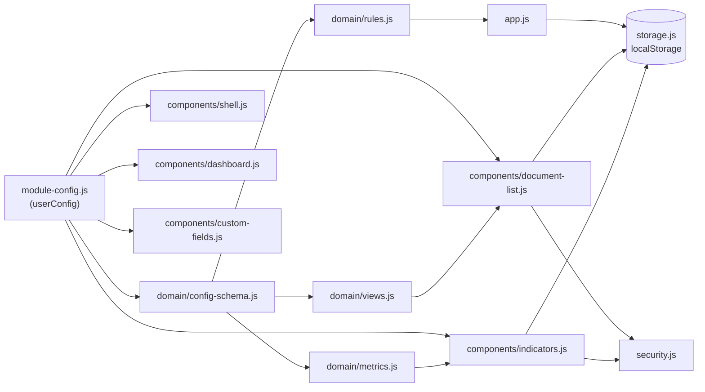

# Plan de Implementación: Módulo ERP de Manufactura y Operaciones

**Rama**: `001-erp-base-module` | **Fecha**: 2026-07-08 | **Actualizado**: 2026-11-05 | **Especificación**: [spec.md](spec.md)
**Entrada**: Especificación de la funcionalidad desde `/specs/001-erp-base-module/spec.md`

## Resumen

Construir una aplicación web ligera con Vite que sirva como módulo ERP de manufactura y operaciones, apoyada en el módulo base de planificación de recursos empresariales. El módulo base proporciona lo común a todo módulo ERP: gestión de datos maestros (Entidades), documentos transaccionales vinculados (Documentos), flujos de crear, editar, eliminar y buscar, validación y persistencia local, construido principalmente con HTML, CSS y JavaScript vanilla.

La aplicación se presenta como un espacio de trabajo ERP coherente: una barra superior con marca (logotipo derivado y nombre del módulo) y una barra lateral persistente de botones de módulo envuelven cada pantalla. La pantalla de entrada es un panel con botones de acción rápida para las tareas clave (nuevo producto, nueva orden de producción, abrir las áreas de gestión, buscar registros) y estadísticas de registros en vivo.

La adaptación a manufactura se realiza mediante el único archivo de configuración `src/module-config.js`, de modo que el código central permanece intacto:

| Concepto base | En Manufactura y Operaciones |
|---|---|
| Entidad | Producto (producto terminado, materia prima o insumo) |
| Documento | Orden de Producción |

El archivo de configuración cubre la terminología, los campos personalizados del dominio (etapa del proceso, máquina, lote, prioridad, cantidad producida, merma, resultado de calidad, entre otros), el ciclo de vida de la orden, el color de acento, las vistas de lista/detalle de órdenes y los indicadores, umbrales y reglas del dominio. El detalle se encuentra en [data-model.md](data-model.md) y en el contrato de extensión [contracts/module-extension.md](contracts/module-extension.md).

### Decisiones de clarificación aplicadas

- **SC-008 aplica a HU1-HU5**: todo el perfil de manufactura se implementa mediante configuración y puntos de extensión declarativos, sin modificar archivos fuente centrales.
- **Lista y detalle de órdenes**: viven dentro del módulo Documentos; la barra lateral mantiene cuatro módulos y no se añade navegación específica de dominio.
- **Sanitización XSS**: FR-050 exige escapar todo valor introducido por el usuario antes de insertarlo en el DOM.
- **Referencias a "la lista"**: en las HU de entidades y criterios de éxito significan los resultados de la pantalla Buscar; la pantalla de gestión no muestra la lista de entidades.
- **Stock bajo el mínimo**: se marca solo si ambos valores existen y `currentStock < minStock`; si falta alguno, se muestra "sin dato" sin insignia.

## Contexto Técnico

**Lenguaje/Versión**: JavaScript (ES2022), HTML, CSS  
**Dependencias Principales**: Vite 8, sin framework de interfaz pesado  
**Pruebas**: Vitest 4 con jsdom para pruebas unitarias y de interacción; Playwright para pruebas E2E de recorridos críticos  
**Almacenamiento**: localStorage del navegador para una instancia del módulo de espacio único  
**Plataforma Objetivo**: Navegadores modernos de escritorio y móviles  
**Tipo de Proyecto**: Aplicación web  
**Objetivos de Rendimiento**: Listas y búsqueda responsivas con 500 registros; búsqueda y filtrado sin recarga completa; agregaciones de indicadores calculadas en una sola pasada sobre los registros en memoria  
**Restricciones**: Huella mínima de librerías, despliegue simple, sin backend requerido; la lógica de dominio debe declararse en configuración y ejecutarse mediante un motor genérico, sin código específico de manufactura en archivos centrales  
**Escala/Alcance**: CRUD de datos maestros (Producto) y documentos transaccionales (Orden de Producción), búsqueda, lista/detalle configurable de órdenes, indicadores y reglas de dominio

## Verificación de la Constitución

*COMPROBACIÓN: Debe pasar antes de la investigación de la Fase 0. Reverificar tras el diseño de la Fase 1.*

| Principio | Cómo se cumple | Puerta de verificación |
|---|---|---|
| **I. Calidad y mantenibilidad** | La lógica de dominio se concentra en un motor declarativo pequeño (`src/domain/`) con operaciones explícitas y validadas; no se usa `eval` ni expresiones arbitrarias. Los límites entre almacenamiento, configuración, vistas y reglas quedan separados. | Revisión de estructura, nombres y ausencia de código específico de manufactura fuera de `module-config.js`. |
| **II. Pruebas y verificación** | Pruebas unitarias para el evaluador de reglas, métricas y validación de configuración; pruebas de integración para lista/detalle, indicadores e insignias; E2E para creación/edición/búsqueda, confirmación de pedido, ejecución y control de calidad. | Suite unitaria, de integración y E2E en verde antes de completar cada incremento. |
| **III. Consistencia de experiencia** | Todas las vistas usan el marco y los tokens existentes; los estados vacíos, errores de validación, insignias y filtros siguen los mismos patrones; se mantiene accesibilidad de teclado y etiquetas. | Revisión de estados vacíos/error, foco, `aria-*` y comportamiento responsivo en las vistas nuevas. |
| **IV. Rendimiento y fiabilidad** | Listas y búsqueda se mantienen para 500 registros; indicadores y costos se calculan en una pasada, sin round-trips ni recálculos por render; no se introduce bloqueo perceptible. | Prueba de volumen con 500 registros y medición de interacción en las vistas nuevas. |
| **Estándares de calidad** | Se añaden linting y formateo al proyecto, se actualiza la documentación cuando cambian comportamiento o contratos y se documenta el motor declarativo. | Scripts de lint/format, documentación actualizada y compilación de producción sin warnings relevantes. |
| **Flujo de trabajo** | Los incrementos se entregan con criterios de aceptación, pruebas y notas de validación; las decisiones de arquitectura quedan registradas en este plan y en `research.md`. | Revisión por incremento y verificación de regresiones. |

**Resultado de la puerta**: pasa. No hay violaciones de la constitución. La complejidad adicional del motor declarativo y de Playwright se justifica en la sección de seguimiento de complejidad.

## Estructura del Proyecto

### Documentación (esta funcionalidad)

```text
specs/001-erp-base-module/
├── plan.md
├── research.md
├── data-model.md
├── quickstart.md
├── contracts/
│   ├── entity-storage.md
│   └── module-extension.md
└── tasks.md
```

### Código Fuente (raíz del repositorio)

```text
index.html            (punto de entrada único; contiene el marcado del marco, panel, formularios y selectores)
src/
├── main.js
├── styles.css
├── storage.js
├── security.js          (escape centralizado y ayudantes de renderizado seguro)
├── app.js
├── module-config.js     (configuración del módulo, incluido manufacturingConfig)
├── components/
│   ├── shell.js         (marco del espacio de trabajo: barra superior, logotipo SVG, barra lateral, estado de módulo activo)
│   ├── dashboard.js     (vista de inicio: cuadrícula de acciones rápidas + tarjetas de estadísticas en vivo)
│   ├── custom-fields.js (renderizado, recolección y relleno de campos personalizados)
│   ├── document-list.js (lista con filtros y detalle configurable dentro del módulo Documentos)
│   └── indicators.js    (indicadores, insignias y resumen de costos por moneda)
└── domain/
    ├── config-schema.js (validación y valores por defecto de la extensión declarativa)
    ├── views.js         (resolución de columnas, filtros y secciones de detalle)
    ├── metrics.js       (conteos, ratios, retrasos y agregaciones por moneda)
    └── rules.js         (evaluación de reglas, guardas de transición e insignias)

tests/
├── unit/
├── integration/
├── e2e/
└── setup/
```

**Decisión de Estructura**: Una aplicación Vite simple con un único punto de entrada HTML, un pequeño conjunto de módulos JavaScript y CSS en un archivo separado. Se usa localStorage para la persistencia. Los componentes se dividen en pares de entidad (datos maestros) y documento (transaccional), y las capacidades específicas del dominio se resuelven con un motor declarativo en `src/domain/` que interpreta `module-config.js`. Esto satisface SC-008: adaptar el módulo a otro dominio requiere editar la configuración, no los archivos centrales.

`shell.js` posee el marco del espacio de trabajo: un logotipo monograma SVG en línea derivado del nombre del módulo, la barra superior y la barra lateral de módulos. `dashboard.js` renderiza las acciones rápidas y las tarjetas de estadísticas. `custom-fields.js` renderiza campos declarados. `document-list.js` renderiza la vista de lista/detalle de documentos declarada por configuración, y `indicators.js` los indicadores, insignias y costos. `security.js` centraliza el escape de contenido y evita insertar datos de usuario como HTML. El estilo se controla mediante propiedades personalizadas de CSS en `styles.css`.



## Extensión Declarativa del Dominio

El módulo base incorpora un contrato de configuración declarativo. La configuración de manufactura no contiene funciones ni código ejecutable; declara datos que el motor genérico interpreta:

```js
domain: {
  documentList: {
    columns: ['series', 'folio', 'entity_id', 'quantity', 'startDate', 'endDate', 'status'],
    filters: [{ key: 'status', op: 'in', optionsFrom: 'statusLifecycle.statuses' }],
    detailSections: [
      { title: 'Pedido', fields: ['series', 'folio', 'entity_id', 'quantity', 'startDate', 'endDate'] },
      { title: 'Ejecución', fields: ['machine', 'batchCode', 'processStage', 'producedQty', 'scrapQty'] },
      { title: 'Calidad', fields: ['qualityResult', 'notes'] }
    ]
  },
  indicators: [
    { id: 'byStatus', type: 'countByField', field: 'status', label: 'Órdenes por estado' },
    { id: 'overdue', type: 'countWhere', where: { all: [
      { field: 'endDate', op: 'lt', value: 'today' },
      { field: 'status', op: 'notIn', value: ['terminada', 'cancelada'] }
    ] }, label: 'Órdenes retrasadas' },
    { id: 'scrapRate', type: 'ratio', numerator: 'scrapQty', denominator: 'producedQty', label: 'Merma' }
  ],
  costSummary: { groupBy: 'currency', fields: ['subtotal', 'discount', 'taxAmount', 'totalAmount'] },
  badges: [
    { target: 'entity', when: { field: 'currentStock', op: 'lt', ref: 'minStock' }, label: 'Stock bajo el mínimo', tone: 'warning' },
    { target: 'document', when: { all: [
      { field: 'endDate', op: 'lt', value: 'today' },
      { field: 'status', op: 'notIn', value: ['terminada', 'cancelada'] }
    ] }, label: 'Retrasada', tone: 'danger' }
  ],
  rules: [
    { target: 'document', when: { field: 'status', op: 'in', value: ['en control de calidad'] },
      require: { field: 'qualityResult', op: 'in', value: ['Aprobado', 'Corrección', 'Rechazado'] },
      message: 'Registre el resultado de calidad antes de cerrar la orden.' }
  ]
}
```

**Reglas del contrato**:

- Las operaciones permitidas se limitan a una lista blanca (`eq`, `neq`, `in`, `notIn`, `lt`, `lte`, `gt`, `gte`, `exists`, `blank`).
- Toda referencia a campo debe existir en los campos base o en `customFields`; si no, la configuración es inválida y se informa (FR-025).
- Las insignias y métricas que dependen de valores ausentes se omiten y muestran "sin dato" cuando corresponde; no se convierten en cero.
- Las reglas no ejecutan código: son predicados y mensajes declarativos evaluados por `src/domain/rules.js`.
- El ciclo de vida de estados sigue siendo la fuente de verdad para las transiciones; las guardas de dominio se evalúan antes de persistir.
- Añadir o cambiar el perfil de dominio se hace en `module-config.js`; los archivos centrales no cambian (SC-008, XR-006).

## Seguridad de Renderizado (FR-050)

- `src/security.js` expone `escapeHtml` y ayudantes que insertan texto mediante `textContent`; los datos de usuario nunca se interpolan en `innerHTML`.
- Las plantillas estáticas pueden usar `innerHTML` solo con contenido controlado por el código, nunca con valores de localStorage o de formularios.
- Los valores se escapan tanto al mostrar listas, detalles, insignias, mensajes de error y configuración inválida como al construir atributos.
- Las pruebas incluyen payloads como `<script>alert(1)</script>`, `">` y URLs `javascript:`.
- No se usan manejadores de eventos inline ni `eval`; el motor declarativo no ejecuta expresiones arbitrarias.

## Fase 0: Investigación

**Objetivo**: Resolver las decisiones técnicas y dejar constancia de alternativas.

Decisiones registradas en [research.md](research.md):

1. Motor declarativo con operaciones de lista blanca en lugar de funciones o `eval` en la configuración.
2. Playwright para E2E, manteniendo Vitest + jsdom para unitarias e integración.
3. Escape centralizado en `security.js` y prohibición de `innerHTML` con datos de usuario.
4. Claves canónicas `producedQty`, `scrapQty` y `qualityResult` para calidad, con etiquetas de interfaz alineadas a la especificación.
5. Umbral estricto de stock bajo y comportamiento "sin dato" cuando falta un valor.
6. Lista y detalle de órdenes dentro del módulo Documentos, sin quinto módulo de navegación.
7. Activación del perfil `manufacturingConfig` como cambio de configuración, no de código.

**Salida**: `research.md` sin `NEEDS CLARIFICATION`.

## Fase 1: Diseño y Contratos

**Prerrequisitos**: `research.md` completo.

1. **Modelo de datos**: actualizar [data-model.md](data-model.md) con el contrato declarativo, la vista de documentos, las métricas, las insignias, las reglas y el mapeo de nombres de calidad.
2. **Contratos**:
   - Actualizar [contracts/entity-storage.md](contracts/entity-storage.md) para reflejar el comportamiento de campos personalizados y datos faltantes.
   - Crear [contracts/module-extension.md](contracts/module-extension.md) con el esquema de configuración, validación, operaciones permitidas y garantía de no modificar archivos centrales.
3. **Guía de validación**: actualizar [quickstart.md](quickstart.md) con escenarios de manufactura, seguridad, stock y rendimiento.

**Salida**: `data-model.md`, `contracts/*` y `quickstart.md` actualizados.

## Estrategia de Implementación

El trabajo posterior a este plan se organiza en frentes que luego se detallan en `tasks.md`:

1. **Motor declarativo y validación**: extender `module-config.js` y `src/domain/config-schema.js` para aceptar y validar vistas, filtros, indicadores, insignias y reglas.
2. **Vista de documentos**: implementar lista con filtros, detalle por secciones y estados vacíos en el módulo Documentos.
3. **Indicadores y costos**: calcular conteos por estado, retrasos, merma y totales por moneda sin sumar monedas distintas.
4. **Reglas y acciones de dominio**: confirmar/rechazar, guardas de transición, validación de cantidades y calidad, y activación de `manufacturingConfig`.
5. **Seguridad, accesibilidad y rendimiento**: escape centralizado, foco y etiquetas accesibles, prueba con 500 registros y presupuesto de interacción.
6. **Pruebas y documentación**: unitarias por regla/métrica, integración por vista, E2E por recorrido crítico y actualización de README/data-model.

## Seguimiento de Complejidad

| Decisión | Justificación | Coste / mitigación |
|---|---|---|
| Motor declarativo de dominio | Es la única forma de cumplir SC-008/XR-006 sin duplicar código de manufactura en archivos centrales. | Mayor complejidad de validación; se mitiga con lista blanca de operaciones y pruebas unitarias del esquema. |
| Playwright como dependencia de desarrollo | La constitución exige cobertura E2E de recorridos críticos y el proyecto no la tiene. | Dependencia adicional solo de desarrollo; no afecta al bundle de producción. |
| Escape centralizado y prohibición de `innerHTML` con datos de usuario | FR-050 exige prevenir XSS de forma verificable. | Requiere auditar las vistas existentes; se cubre con pruebas de payloads. |
| Indicadores calculados en una pasada | Mantiene la responsividad con 500 registros y evita recálculos por render. | Lógica de agregación adicional; se aisla en `src/domain/metrics.js`. |

No se introducen violaciones de la constitución. Las decisiones anteriores agregan complejidad justificada por requisitos explícitos de la especificación.

---

# Anexo: Informe de Avance

| | |
|---|---|
| **Equipo** | Grupo 7 |
| **Tipo de entrega** | Avance |
| **Fecha de entrega** | _[completar]_ |

| Integrante | Rol |
|---|---|
| Vicente Javier Seguel Fuentes | Líder de producto |
| Rafael Antonio Machuca López | Arquitecto de datos |
| Constanza Andrea Chavarría Ortiz | Diseño de experiencia y usuario |
| Francisca Belén Torres Torres | Control de calidad del producto |
| Alonso Javier Romero Gutiérrez | Desarrollo e infraestructura |

## Alcance de esta etapa

**Incluido**: gestión de productos y órdenes de producción, búsqueda, validación, persistencia local, espacio de trabajo con panel de inicio, lista/detalle configurable de órdenes, indicadores y reglas de dominio declarativas.

**Incluido como configuración de dominio**: máquina, lote, proveedor, etapa del proceso, prioridad, cantidades producidas, merma, resultado de calidad, retrasos, stock bajo el mínimo, merma por orden y costos por moneda.

**Fuera de alcance**: lista de materiales y consumo de insumos por orden; máquinas, lotes y proveedores como registros independientes con su propio ciclo de vida; alertas automáticas (notificaciones) de stock bajo o de órdenes retrasadas; backend, autenticación y múltiples usuarios.

## Estado del avance

| Entregable | Estado |
|---|---|
| Especificación funcional | Completado; 5 clarificaciones integradas |
| Modelo de datos documentado | Completado; se actualiza con el contrato declarativo |
| Configuración del módulo (`userConfig = null`, valores predeterminados activos; `manufacturingConfig` de ejemplo) | Completado |
| Validación de la configuración en ejecución | Completado para el núcleo; pendiente extenderla a vistas, indicadores y reglas |
| Revisión de concordancia gramatical en la interfaz | Completado para el núcleo base; el perfil de manufactura se revisa en la HU5 (Fase 7 de `tasks.md`) |
| Datos de ejemplo (productos y órdenes) | Pendiente (T004 de `tasks.md`) |
| Pruebas automatizadas del núcleo base | Completado (12 archivos, 111 pruebas en verde) |
| Pruebas E2E de recorridos críticos | Pendiente (T070-T073 de `tasks.md`) |
| Linting y formateo | Pendiente (T001-T002 y T074 de `tasks.md`) |
| Compilación de producción | Completado (`npm run build`) |
| Lógica de dominio de manufactura (HU1-HU5) | Pendiente (Fases 2-7 de `tasks.md`), diseñada como extensión declarativa |
| Documentación actualizada tras los cambios de dominio | Pendiente (T075-T076 de `tasks.md`) |

## Riesgos y consideraciones

| Riesgo | Mitigación |
|---|---|
| El motor declarativo se vuelve demasiado complejo o rígido | Lista blanca pequeña de operaciones, validación estricta y pruebas unitarias del esquema antes de ampliar. |
| La restricción de configuración sin cambios centrales choca con vistas de dominio complejas | `document-list.js`, `indicators.js` y `src/domain/` son genéricos; la configuración declara columnas, filtros, métricas y reglas, no código. |
| Nombres de calidad inconsistentes (`CantidadQA` vs `producedQty`) | Claves canónicas en datos y etiquetas de interfaz alineadas a la especificación; mapeo documentado en `data-model.md`. |
| Los artículos en español se derivan de la primera palabra del término; "Orden de Producción" es femenino pero "Orden" no termina en "a" | Mitigado en `shell.js`: `isFeminine` trata "orden" como femenino y `lowerLabel` normaliza la etiqueta completa. |
| `quantity` solo admite enteros positivos | Usar un campo propio numérico para cantidades con decimales cuando el dominio lo requiera. |
| El módulo base maneja un único par entidad/documento | Extender el motor declarativo con un segundo par si se requiere trazabilidad completa de máquinas, lotes y proveedores. |
| Reglas de negocio no cubiertas por el módulo base (producción más merma frente a lo planificado; terminar solo con calidad aprobada) | Implementar guardas declarativas en `rules.js` y validaciones adicionales en una etapa posterior. |
| XSS en datos persistidos | Escape centralizado en `security.js`, prohibición de `innerHTML` con datos de usuario y pruebas con payloads. |

## Próximos pasos

1. Completar la Fase 1 de `tasks.md`: añadir lint, formato y Playwright.
2. Completar la Fase 2: motor declarativo, seguridad y perfil de configuración.
3. Implementar la HU1 como MVP del perfil de manufactura (lista/detalle, acciones, indicadores y costos).
4. Continuar con HU2-HU5 y validar cada historia de forma independiente.
5. Activar `manufacturingConfig` en `userConfig` y verificar que no aparece el aviso de configuración inválida.
6. Cargar datos de ejemplo de productos y órdenes para validar los flujos de dominio.
7. Ejecutar la validación de `quickstart.md`, incluyendo seguridad, stock bajo y rendimiento con 500 registros.
8. Actualizar README y `data-model.md` cuando la implementación del perfil quede cerrada.
